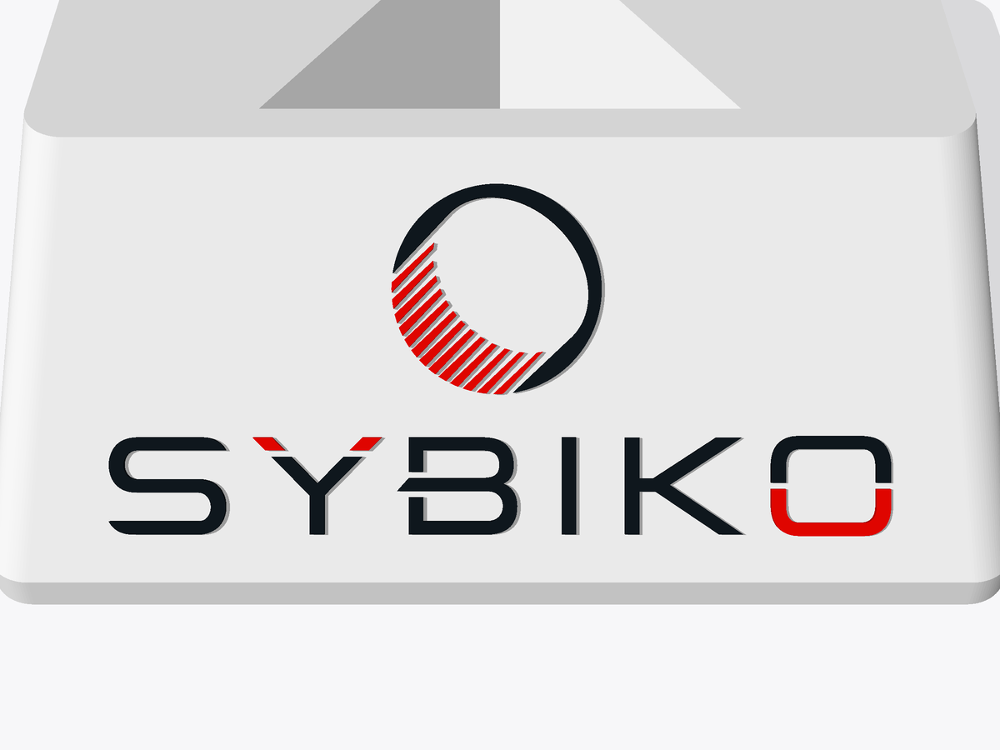

# SYBIKO Rubik's cube stand

A 3D-printable display stand for a Rubik's cube. The cube balances on one corner in a
three-sided pocket, and the SYBIKO logo is raised on the slanted face in front of it.


| Two-colour logo | Single colour |
| --- | --- |
|  |  |

## Files to print

Everything is in [`output/`](output), in millimetres, already oriented for printing (flat base down).

| File | Use |
| --- | --- |
| `cube_stand.stl` | Single-colour print: one solid with the logo raised 0.6 mm. |
| `cube_stand_multicolor.3mf` | Multi-colour print: body, dark logo and red logo as three parts of one object. |
| `cube_stand_body.stl`, `cube_stand_logo_10181e.stl`, `cube_stand_logo_e10600.stl` | The same three parts as separate STLs. Import them together and accept "load as a single object with multiple parts". |

The stand is 88 × 74 × 30 mm and fits a standard 57 mm 3×3 cube. The pocket is a plain cube
corner, so smaller and larger cubes sit in it too.

## Printing

- No supports. The pocket opens upward and the logo sits on a 45° face.
- 0.4 mm nozzle, 0.2 mm layers or finer, 3 walls, 10–15 % infill.
- The red stripes in the emblem are 0.6 mm wide with 0.5 mm gaps. If your slicer drops them,
  enable thin-wall detection (Arachne) or regenerate with a larger `--logo-width`.
- Logo colours: `#10181E` (dark) and `#E10600` (red).



## Changing the design

`stand.py` generates everything from [`logo/SYBIKO.svg`](logo/SYBIKO.svg):

```sh
pip install -r requirements.txt
python stand.py                      # rewrites output/
python stand.py --cube-size 56 --logo-width 72 --emboss 0.8
python stand.py --help               # all parameters and their defaults
python preview.py                    # re-renders the images in docs/
```

Any SVG made of filled shapes works with `--logo`; each fill colour becomes its own part.
