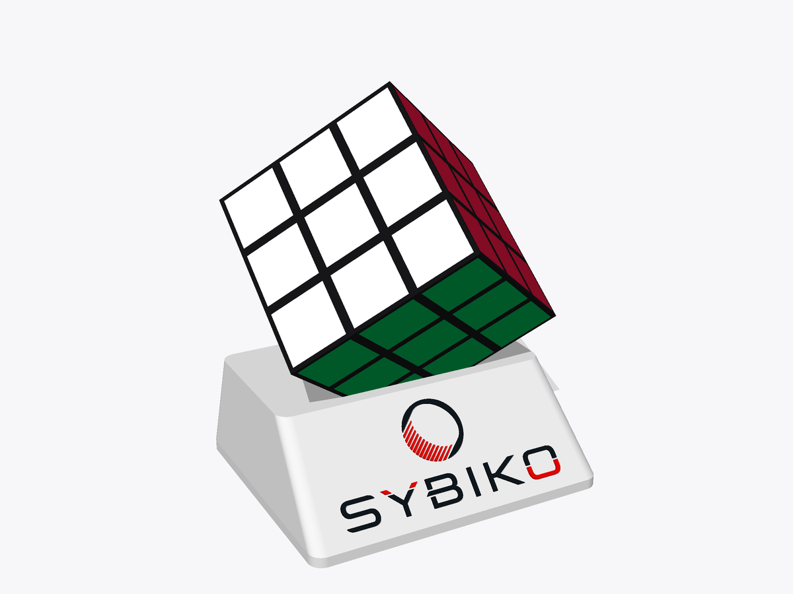
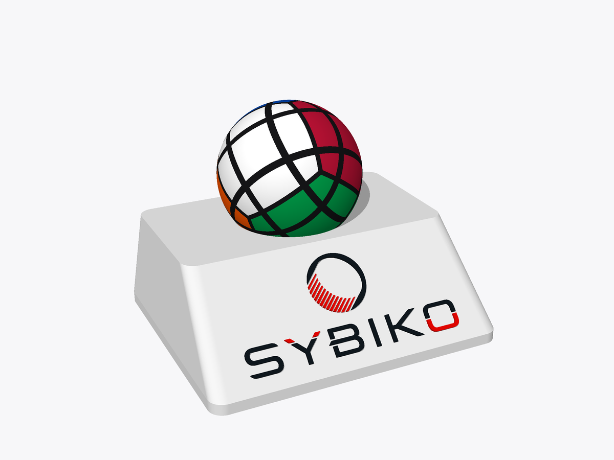
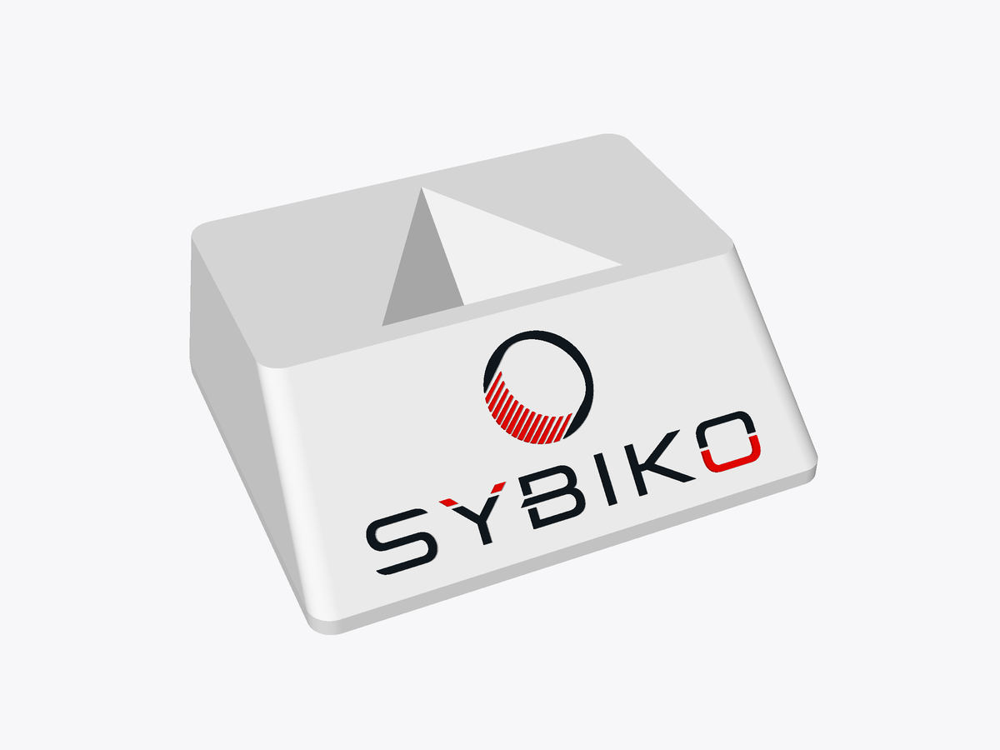
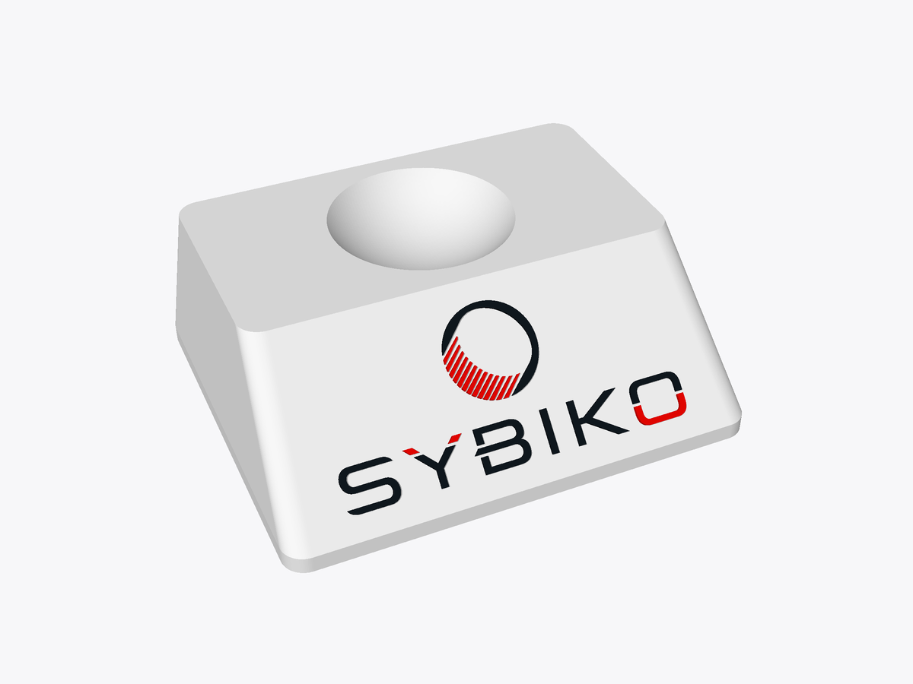
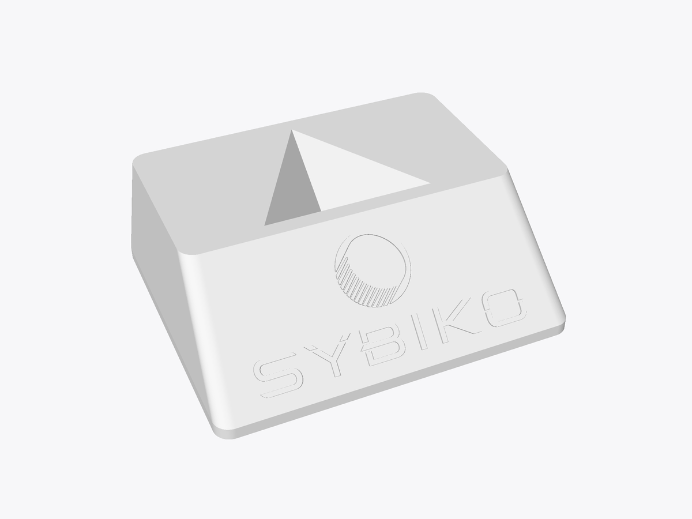
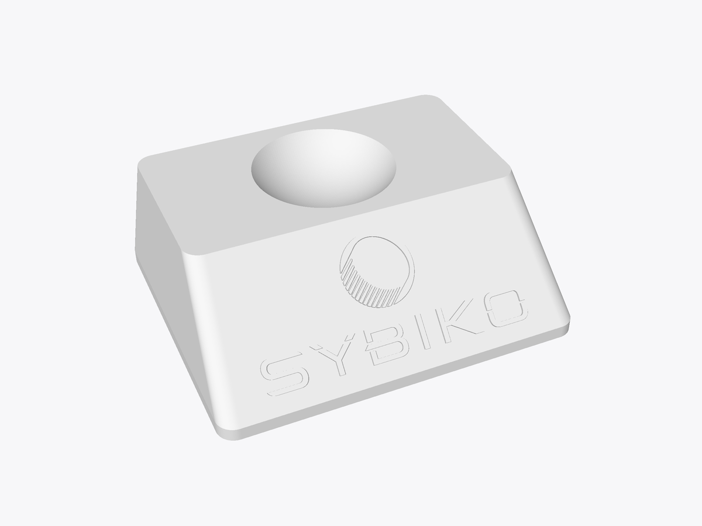
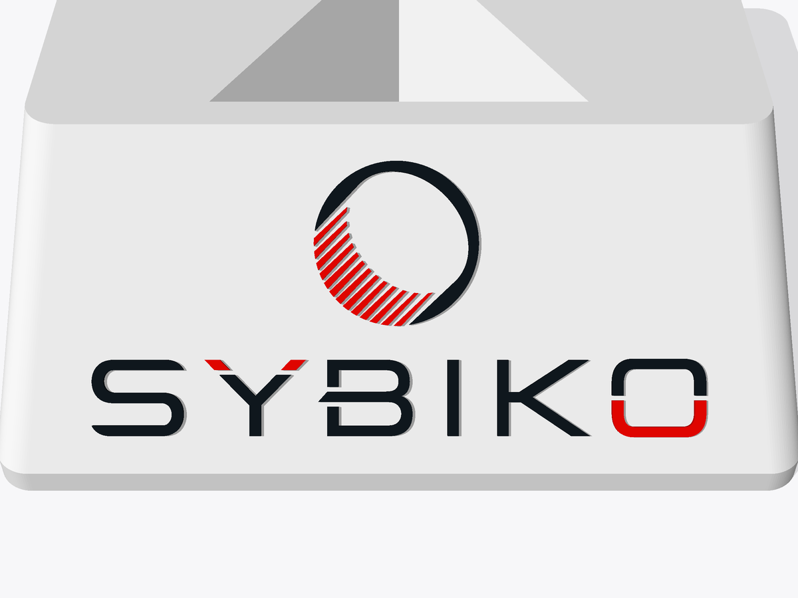
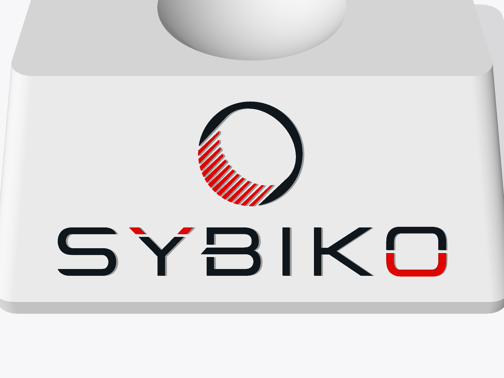

# SYBIKO Rubik's puzzle stands

3D-printable display stands with the SYBIKO logo raised on a slanted front face. There are two:
one for a Rubik's cube, which balances on a corner in a three-sided pocket, and one for a
40 mm sphere-shaped cube, which rests in a round dish.

| Cube stand | Sphere stand |
| --- | --- |
|  |  |
|  |  |

| | Cube stand | Sphere stand |
| --- | --- | --- |
| Fits | 57 mm 3×3 cube | 40 mm sphere |
| Size | 88 × 74 × 30 mm | 82 × 68 × 28 mm |
| Pocket | cube corner, 17 mm deep | dish, 8 mm deep and 32 mm across |
| Logo width | 66 mm | 60 mm |

The cube pocket is a plain cube corner, so smaller and larger cubes sit in it too. The dish is
0.3 mm larger in radius than the sphere, so the sphere seats on the bottom without binding.

## Files to print

Everything is in [`output/`](output), in millimetres, already oriented for printing (flat base
down). Each stand has the same set of files, named `cube_stand…` or `sphere_stand…`:

| File | Use |
| --- | --- |
| `…_stand.stl` | Single-colour print: one solid with the logo raised 0.6 mm. |
| `…_stand_multicolor.3mf` | Multi-colour print: body, dark logo and red logo as three parts of one object. |
| `…_stand_body.stl`, `…_stand_logo_10181e.stl`, `…_stand_logo_e10600.stl` | The same three parts as separate STLs. Import them together and accept "load as a single object with multiple parts". |

## Printing

- No supports. The pockets open upward and the logo sits on a 45° face.
- 0.4 mm nozzle, 0.2 mm layers or finer, 3 walls, 10–15 % infill.
- The red stripes in the emblem are the finest detail: about 0.6 mm wide on the cube stand and
  0.5 mm on the sphere stand, with gaps down to 0.3 mm on both. A 0.4 mm nozzle will likely
  merge some of them. For crisp stripes use a 0.2–0.25 mm nozzle, or regenerate with a wider
  logo (`--logo-width 90` brings the gaps to about 0.45 mm).
- Logo colours: `#10181E` (dark) and `#E10600` (red).

| Cube stand, single colour | Sphere stand, single colour |
| --- | --- |
|  |  |
|  |  |

## Changing the design

`stand.py` generates everything from [`logo/SYBIKO.svg`](logo/SYBIKO.svg):

```sh
pip install -r requirements.txt
python stand.py                      # rewrites the cube stand in output/
python stand.py --shape sphere       # rewrites the sphere stand in output/
python stand.py --shape sphere --sphere-diameter 45 --pocket-depth 9
python stand.py --cube-size 56 --logo-width 72 --emboss 0.8
python stand.py --shape sphere --help  # all parameters and their defaults for that shape
python preview.py                    # re-renders the images in docs/
```

Any SVG made of filled shapes works with `--logo`; each fill colour becomes its own part.
