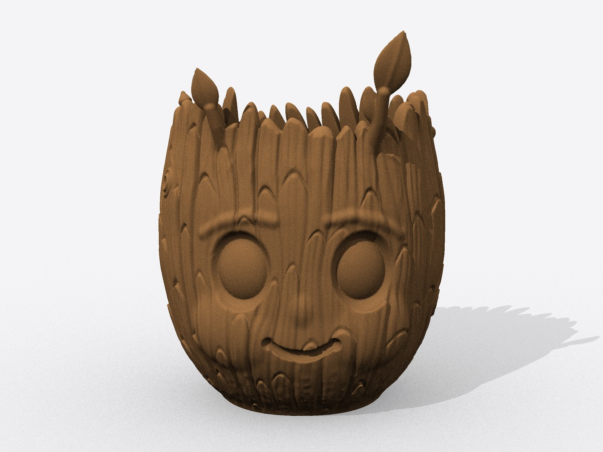
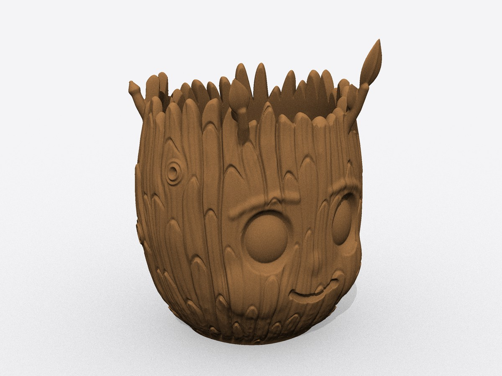
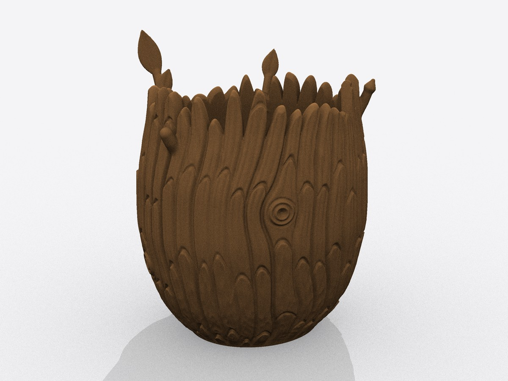
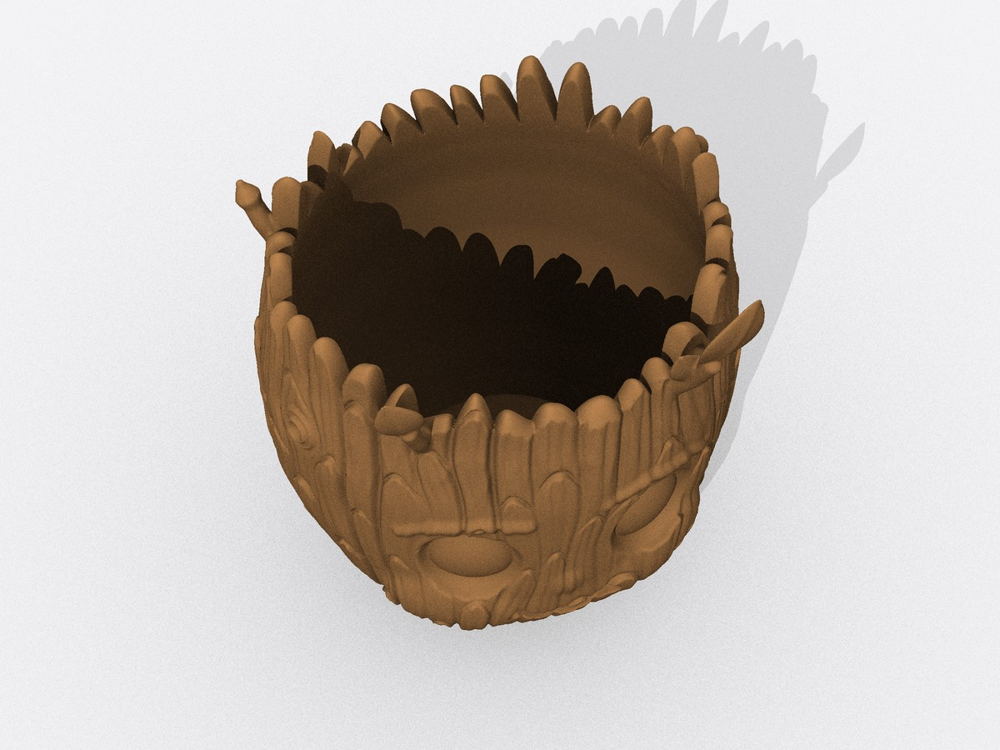
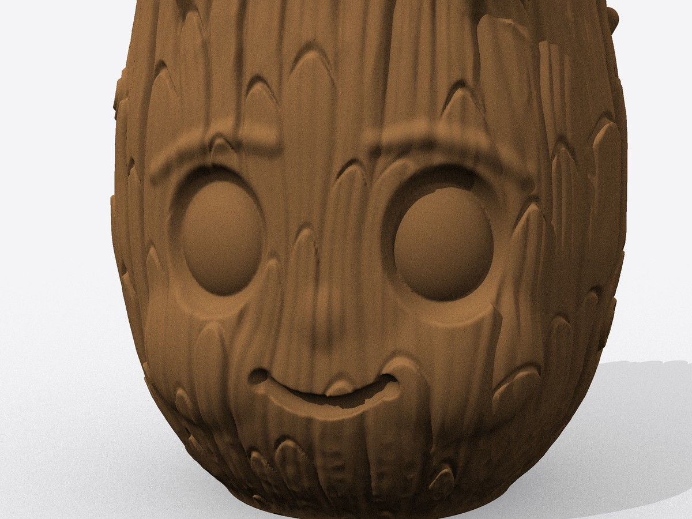
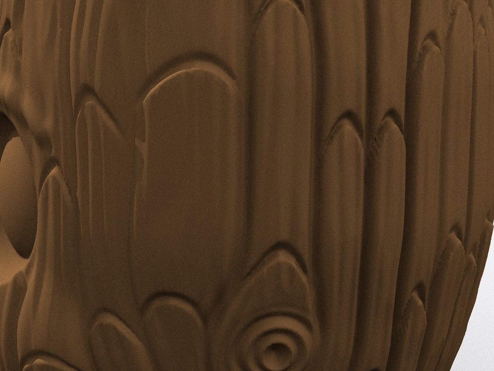

# Groot head planter

A 3D-printable flower pot in the shape of Groot's head. It is one solid piece for printing in a
single colour.

| | |
| --- | --- |
|  |  |
|  |  |
|  |  |

## The model

[`output/groot_pot.stl`](output/groot_pot.stl) is in millimetres and stands on its flat base,
ready to print.

| | |
| --- | --- |
| Size | 107 × 98 × 134 mm; the head is 117 mm tall, the leaves reach above it |
| Holds | about 0.5 litre |
| Opening | about 87 × 78 mm |
| Wall | 4.5 mm under the bark, 4.5 mm floor |
| Drainage | one 8 mm hole in the floor |
| Mesh | about 590,000 triangles, 29 MB |

The surface detail:

- bark made of 34 strands, each a stack of overlapping plates with pointed tips
- cracks between some strands, finer ridges on each strand and a 0.2 mm wood grain
- four knots with growth rings
- a crown of broken sticks, each with its own height, point and slant
- a face with domed eyes set in sockets, brow ridges, cheeks and a smile; the bark flows around the eyes
- two twigs with leaves, a twig with a bud and a broken stub

## Printing

- Print it as it stands, without supports. The pot widens gently from the base, and only about
  0.3 % of the surface overhangs by more than 50°, mostly in small ledges of the bark.
- Use a 0.4 mm nozzle or smaller and 0.12–0.16 mm layers; the wood grain is lost at coarser
  layers. 3 walls and 15 % infill are enough.
- The twigs and leaves are the most delicate parts. The twigs are 3.6–6 mm thick and the leaves
  2.2–2.4 mm at their middle; print them slowly with good cooling.
- The bark fades out over the lowest 7 mm so that the first layer is a clean oval.
- Printed plastic is rarely watertight. Seal the inside, or put the plant in a plain inner pot.
  Stand the pot on a saucer, or generate it without the drainage hole.
- To change the size, scale the file in your slicer or use `--scale`.

## Changing the model

`groot_pot.py` sculpts the head as a distance field and meshes it. The proportions, the face and
the bark are plain numbers at the top of the file and in `Model`.

```sh
pip install -r requirements.txt
python groot_pot.py                  # rewrites output/groot_pot.stl, takes about half a minute
python groot_pot.py --scale 1.3      # a larger pot
python groot_pot.py --no-drain       # without the drainage hole
python groot_pot.py --resolution 0.5 --triangles 0 --out draft.stl   # quick draft
python groot_pot.py --help
python preview.py                    # re-renders the images in docs/
```

This is a fan-made model for personal use. Groot is a Marvel character; the model is not
affiliated with or endorsed by Marvel.
